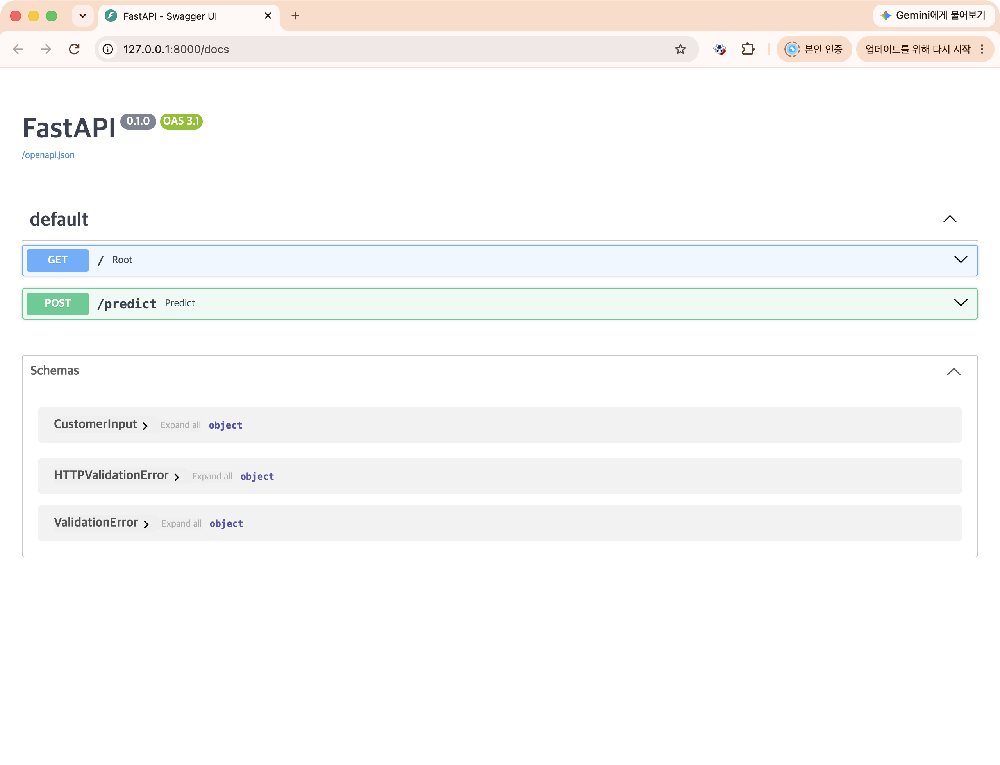
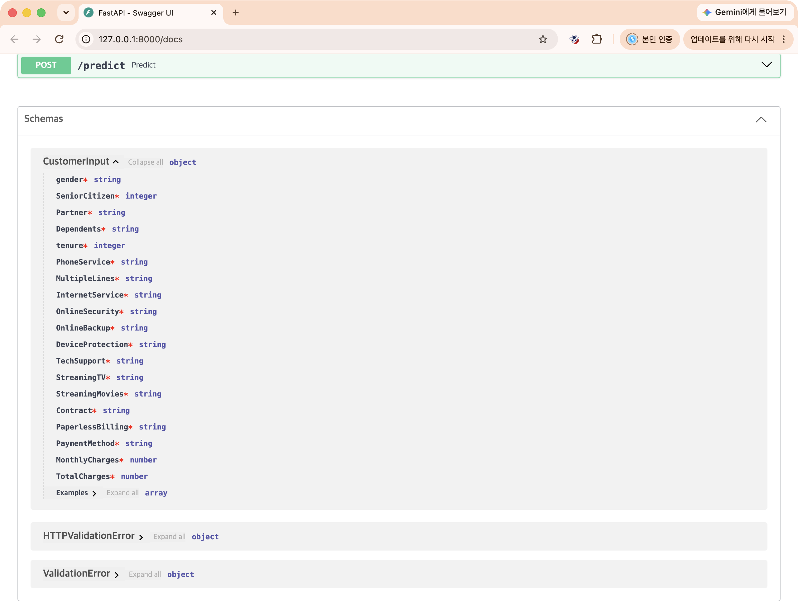
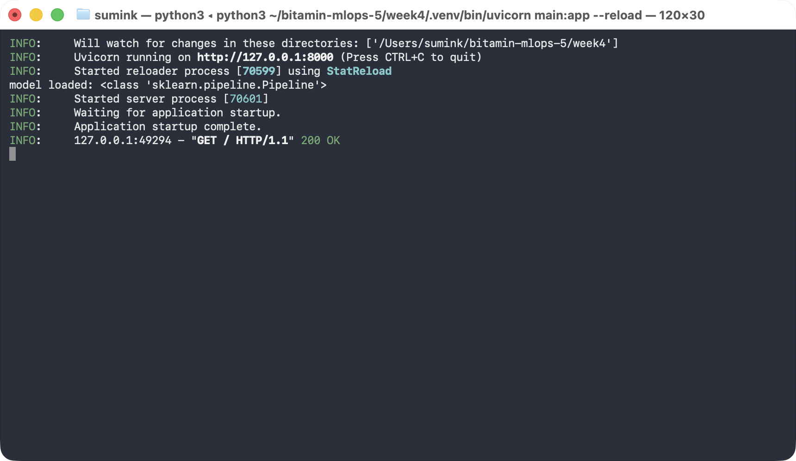
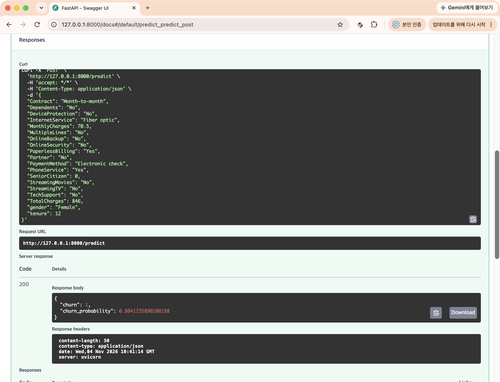
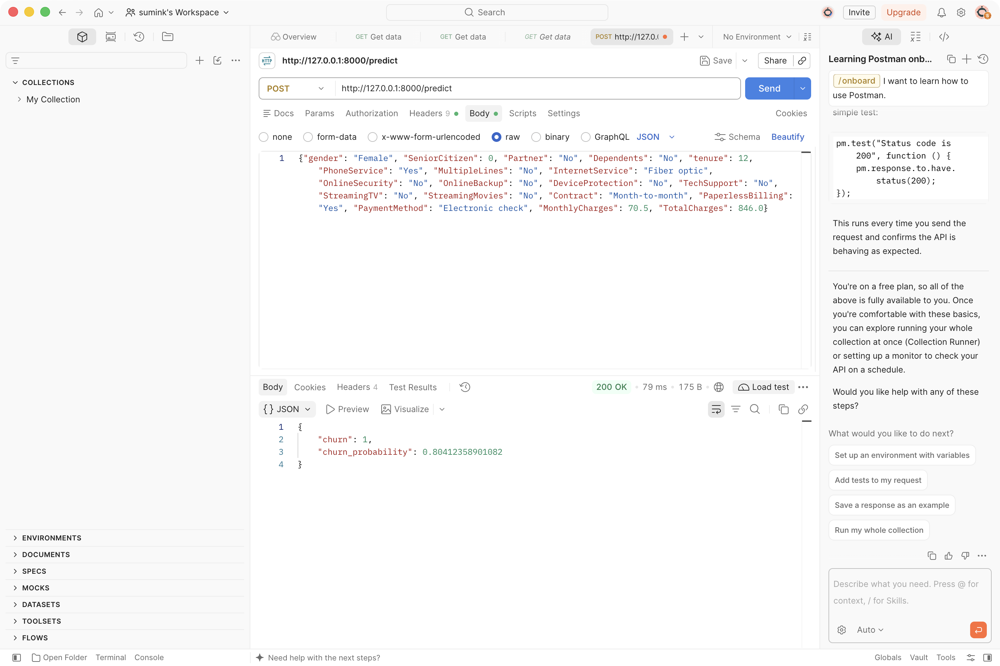

# Week4 — FastAPI 모델 서빙

3주차에 저장한 `churn_model.joblib`(전처리 + RandomForest Pipeline)을 FastAPI로 감싸 `POST /predict`로 이탈 예측을 제공한다.

## 실행

```bash
source .venv/bin/activate
pip install -r requirements.txt
uvicorn main:app --reload
```

- Swagger: http://127.0.0.1:8000/docs

## API 명세

| 메서드 | 경로 | 설명 |
|---|---|---|
| GET | `/` | 서버 확인 → `{"message": "ok"}` |
| POST | `/predict` | 고객 정보로 이탈 예측 |

### 입력 (Request Body, JSON)

3주차 학습 데이터(X_train)와 같은 19개 컬럼. 하나라도 빠지거나 타입이 틀리면 **422**.

| 필드 | 타입 | 값 |
|---|---|---|
| gender | str | Female / Male |
| SeniorCitizen | int | 0 / 1 |
| Partner, Dependents, PhoneService, PaperlessBilling | str | Yes / No |
| tenure | int | 가입 개월 수 |
| MultipleLines | str | Yes / No / No phone service |
| InternetService | str | DSL / Fiber optic / No |
| OnlineSecurity, OnlineBackup, DeviceProtection, TechSupport, StreamingTV, StreamingMovies | str | Yes / No / No internet service |
| Contract | str | Month-to-month / One year / Two year |
| PaymentMethod | str | Electronic check / Mailed check / Bank transfer (automatic) / Credit card (automatic) |
| MonthlyCharges | float | 월 요금 |
| TotalCharges | float | 누적 요금 |

```json
{
  "gender": "Female", "SeniorCitizen": 0, "Partner": "No", "Dependents": "No",
  "tenure": 12, "PhoneService": "Yes", "MultipleLines": "No",
  "InternetService": "Fiber optic", "OnlineSecurity": "No", "OnlineBackup": "No",
  "DeviceProtection": "No", "TechSupport": "No", "StreamingTV": "No",
  "StreamingMovies": "No", "Contract": "Month-to-month", "PaperlessBilling": "Yes",
  "PaymentMethod": "Electronic check", "MonthlyCharges": 70.5, "TotalCharges": 846.0
}
```

### 출력 (200 OK)

```json
{"churn": 1, "churn_probability": 0.80412358901082}
```

- `churn`: 예측 라벨 (1 = 이탈)
- `churn_probability`: 클래스 1(이탈)의 확률

같은 입력으로 로컬에서 `model.predict_proba` 결과(0.80412358901081...)와 API 응답이 일치함을 확인했다 → 전처리 재현 OK.

## 체크포인트

### 1. FastAPI 서버 기동 및 Swagger 접속


### 2. Pydantic 스키마 정의


### 3. 모델 로드 및 /predict 구현 (코드와 기동 로그)


### 4. Swagger에서 예측 요청 성공


### 5. Postman으로 동일 요청 테스트
`POST http://127.0.0.1:8000/predict`, Body → raw → JSON에 위 입력 예시를 넣고 Send.

