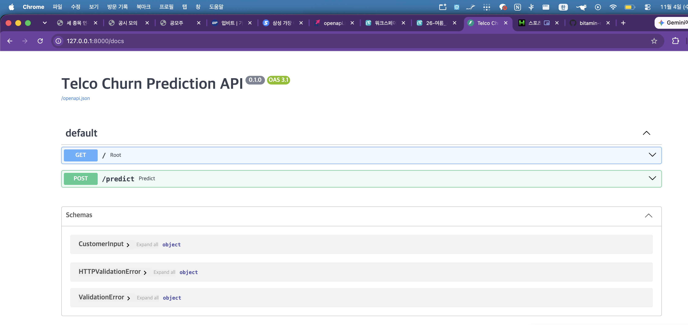
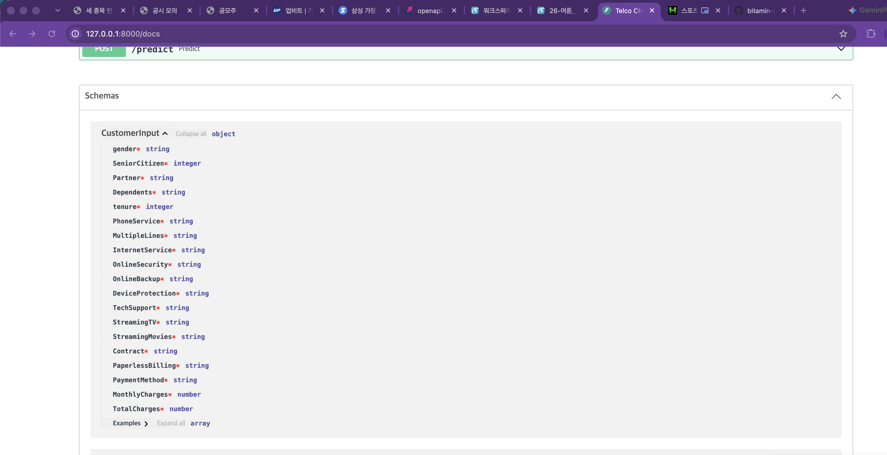
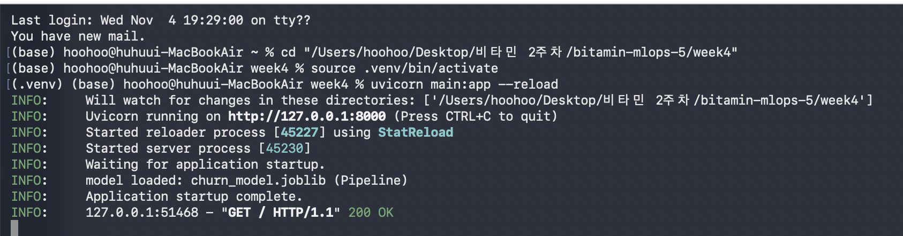
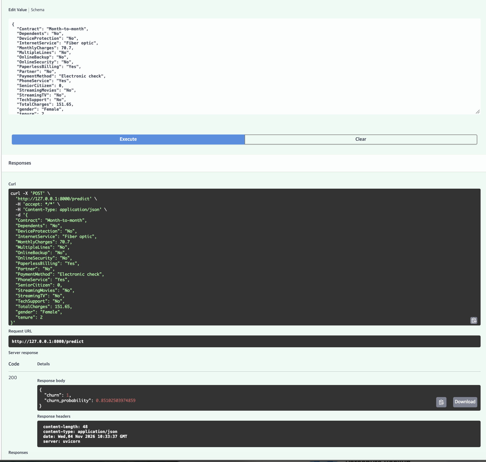
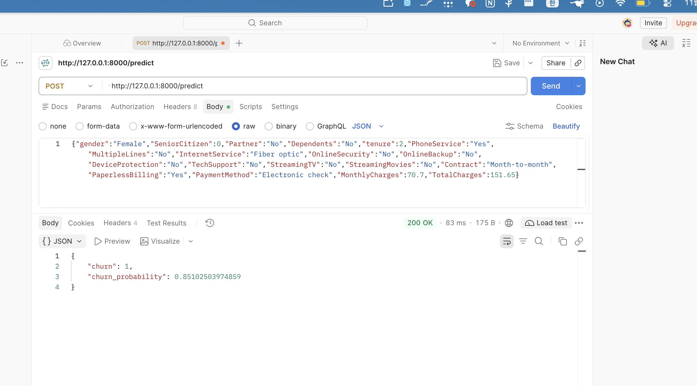

# Week 4 — FastAPI 모델 서빙

`week3`에서 저장한 `churn_model.joblib`(sklearn Pipeline)을 FastAPI로 서빙한다.

```bash
cd week4
python -m venv .venv && source .venv/bin/activate
pip install -r requirements.txt
uvicorn main:app --reload
```

| 파일 | 역할 |
| --- | --- |
| `main.py` | 앱, 서버 시작 시 모델 1회 로드(`lifespan`), `GET /`, `POST /predict` |
| `schema.py` | 고객 정보 입력용 Pydantic 스키마 `CustomerInput` (+ Swagger 예시값) |
| `churn_model.joblib` | 전처리 + 모델이 함께 저장된 Pipeline |

## API 명세

`POST /predict` — 입력(19개 필드, `schema.py` 참고) → 출력

```json
{"churn": 1, "churn_probability": 0.851}
```

형식이 틀린 입력은 모델에 닿기 전에 `422`로 차단된다.

## 체크포인트

### 1. FastAPI 서버 기동 및 Swagger 접속
`http://127.0.0.1:8000/docs`



### 2. Pydantic 스키마 정의
`schema.py`의 `CustomerInput`이 Swagger Schemas에 표시된다.



### 3. 모델 로드 및 `/predict` 구현
코드는 `main.py` 참고. `lifespan`에서 서버 시작 시 `churn_model.joblib`을 1번만 로드한다.



### 4. Swagger에서 예측 요청 성공
POST `/predict` → Try it out → Execute → 200



### 5. Postman으로 동일 요청 테스트
같은 고객 데이터로 POST → `200 OK`, Swagger와 같은 확률



`{"churn": 1, "churn_probability": 0.85102503974859}`

형식이 틀린 입력(예: `{"tenure":"abc"}`)은 `422`로 차단된다.
